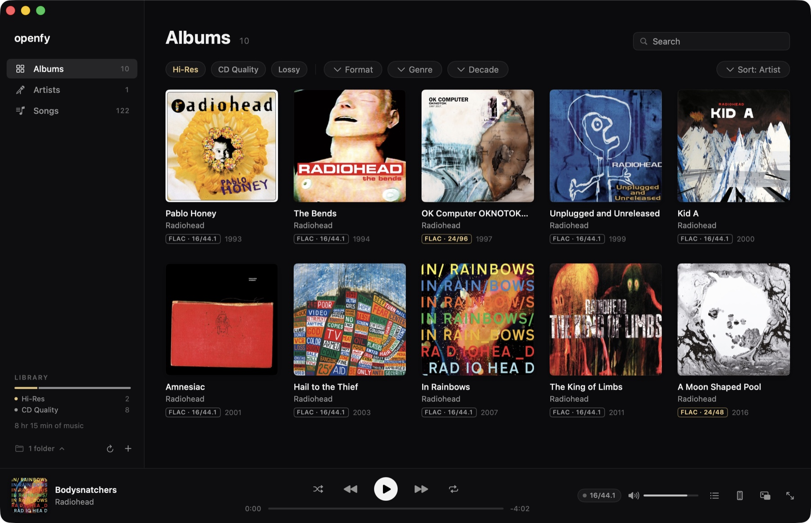
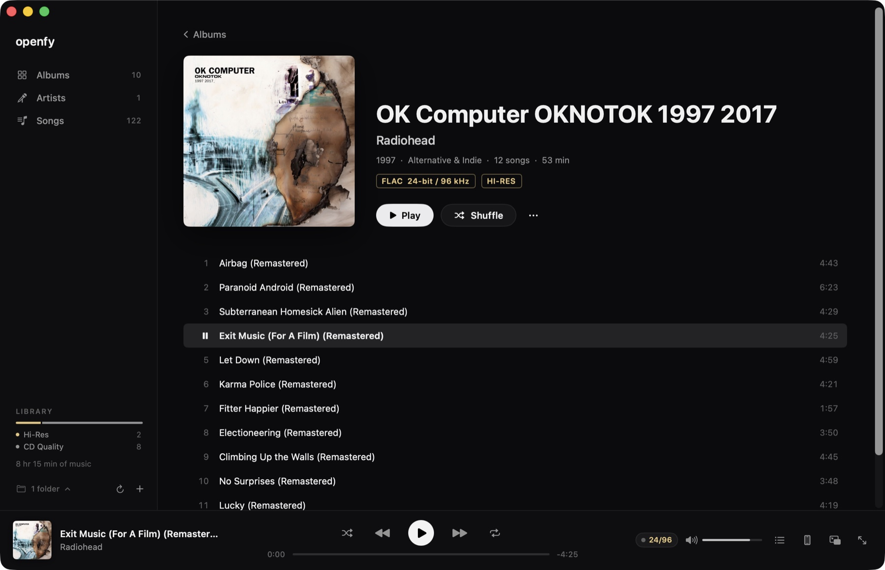
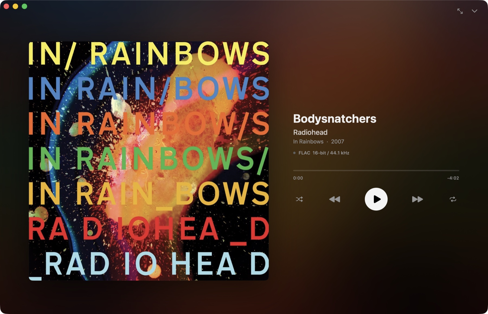
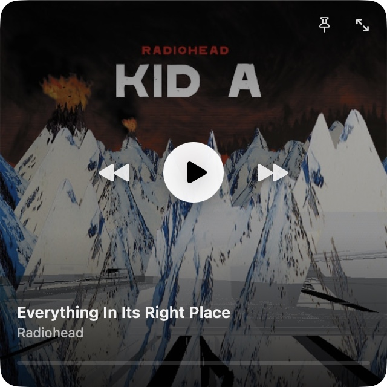
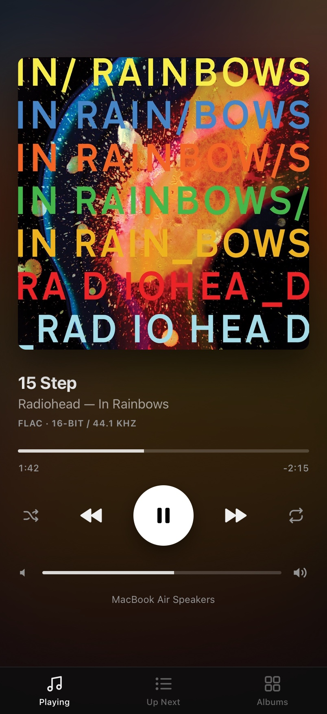
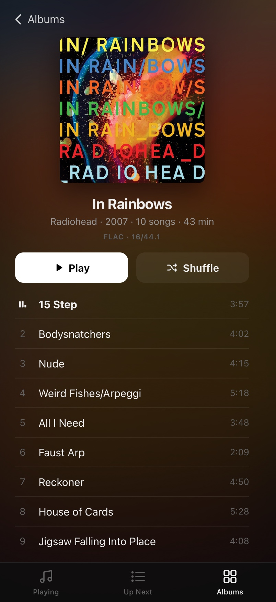
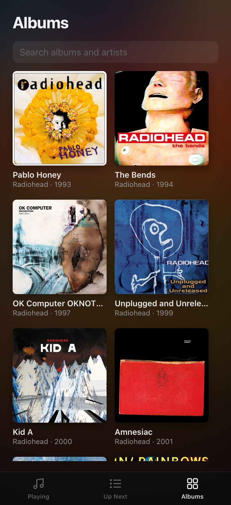

# Openfy

**Free and open source (MIT).** A minimal, dark music player for macOS, made for your own collection:
ripped CDs and albums bought as downloads. It plays every format from MP3 to 24-bit/192 kHz FLAC **bit-perfect**.
It never alters your files. No account, no subscription, no tracking, and no third-party dependencies.



<p>
  
  
</p>

**Mini player** and the **phone remote** (control the Mac from your iPhone; the music keeps playing on the Mac):

<p>
  
  &nbsp;
  
  
  
</p>

## Features


- **Lossless, bit-perfect playback.** Openfy switches your output device to each file's native sample rate,
  so macOS never resamples. At 100% app volume the samples reach the hardware unchanged.
  A green dot in the player bar confirms it; click it to see the full signal path.
- **Gapless.** Tracks with the same format play back to back with no gap (live albums, DJ mixes, classical).
- **Formats:** FLAC, ALAC, WAV, AIFF, MP3, AAC (`.flac .m4a .mp4 .wav .aif .aiff .aifc .mp3 .aac .caf`).
- **Covers:** embedded artwork (FLAC, ID3, MP4), or `cover.jpg`, `folder.jpg`, `front.png`… in the album folder.
- **Filters:** Hi-Res / CD Quality / Lossy, format, genre, decade, plus instant search across albums, artists and songs.
- **Untagged rips work too:** missing tags are inferred from `Artist/Album (Year)/01 Title.flac` and `CD1/CD2` folders.
- **Now Playing view:** click the cover in the player bar for a big cover on a blurred backdrop while the music keeps
  playing. Press F (or double-click the cover) for true full screen. Controls and the cursor fade out when the mouse is idle.
- **Mini player:** drag the window small (or press ⌥⌘M) and it becomes a square with just the album cover;
  hover for play/pause, previous/next and a progress bar. Drag the cover to move it, double-click it (or ⌥⌘M) to go
  back to the full window, and pin it to keep it above other windows.
- **Phone remote:** click the phone icon in the player bar, turn it on and scan the QR code with your iPhone. You get
  the cover, play/pause, skip, seek, volume, the up-next list and your albums (open one and tap any song), while the music keeps playing from the
  Mac. In Safari tap Share → Add to Home Screen and it opens like an app. It's a web page served over your Wi-Fi, so
  there's nothing to install, no App Store and no developer account. The volume slider controls the Mac's own
  volume, so playback stays bit-perfect. Every request needs the secret token in the link, and **New Link** revokes it.
- Media keys, Control Center "Now Playing", queue, shuffle, repeat, and it remembers where you left off.

## Download

Get the latest **Openfy.app** from [Releases](https://github.com/nijv/openfy/releases/latest) (Apple Silicon, macOS 14+).
Unzip it and drag it to Applications.

The app is free and isn't signed with a paid Apple Developer ID, so the first time you open it macOS says it
"could not verify" it. That only happens once:

1. Open Openfy and click **Done** on the warning.
2. Go to **System Settings → Privacy & Security**, scroll down, and click **Open Anyway** next to Openfy.

Or in Terminal: `xattr -dr com.apple.quarantine /Applications/Openfy.app`

You can also build it yourself from source (below); it's the same app.

## Requirements

- macOS 14 Sonoma or later, Apple Silicon
- Xcode or the Xcode Command Line Tools (Swift 5.10+), to build it yourself

## Build & run

```bash
git clone https://github.com/nijv/openfy.git
cd openfy
./scripts/build-app.sh            # → build/Openfy.app
./scripts/build-app.sh --install  # also copies it to /Applications
```

Open the app, click **Add Music Folder** (or drag a folder onto the window), and your library is scanned.
Rescans are incremental: only new or changed files are read.

Run the tests (they create real FLAC/ALAC/AAC/WAV files with macOS's `afconvert`):

```bash
swift test
```

## Keyboard

| Key | Action |
| --- | --- |
| Space | Play / pause |
| ⌘→ / ⌘← | Next / previous |
| ⌥⌘→ / ⌥⌘← | Skip ±10 s |
| ⌘↑ / ⌘↓ | Volume |
| ⌘F | Search |
| ⌘1 / ⌘2 / ⌘3 | Albums / Artists / Songs |
| ⌘L | Go to current album |
| ⇧⌘F | Now Playing (big cover) |
| ⌥⌘M | Mini player / full window |
| F / Esc | In Now Playing: full screen / close |
| ← / → | In Now Playing or the mini player: previous / next track |
| ⌘O / ⌘R | Add folder / Rescan |
| Esc or ⌘[ | Back |

## How "no quality loss" works

1. **Decoding:** Apple's Core Audio decodes FLAC/ALAC/WAV/AIFF into 32-bit float. Float32 represents every 16- and
   24-bit integer sample *exactly*, so this step is lossless.
2. **No resampling:** before playback, Openfy sets the output device's hardware rate
   (`kAudioDevicePropertyNominalSampleRate`) to the file's rate: 44.1 kHz for CDs, 96 kHz for hi-res, and so on.
   Your original device rate is restored when you quit.
3. **No processing:** there's no EQ, no normalisation, no crossfade. At 100% app volume the mixer multiplies by
   exactly 1.0. Control loudness with your Mac's volume keys or your DAC, not the app slider.

What still limits quality is outside the app:

- **Built-in MacBook speakers** support up to 96 kHz and apply Apple's speaker tuning in hardware. 192 kHz files are
  resampled by macOS's high-quality converter, and the indicator turns amber to tell you.
- **Bluetooth (AirPods etc.)** re-encodes audio wirelessly, so it is never lossless. Use wired headphones or a USB DAC.
- **External DACs** that support 192 kHz (or more) play everything natively.

## Project layout

```
Sources/OpenfyCore/   Tag readers (FLAC, ID3v1/v2, MP4, RIFF/AIFF), scanner, cover cache, grouping, filters
Sources/Openfy/       SwiftUI app: Audio/ (CoreAudio device control, engine, queue), Views/, App/,
                      Remote/ (phone remote: tiny HTTP server + the web page)
Tests/                Unit + integration tests with generated audio files
scripts/              build-app.sh, make-icon.swift
```

No third-party dependencies, only Apple frameworks.

Library data lives in `~/Library/Application Support/Openfy` (`library.json` and the `Covers/` cache).
Delete that folder to start fresh. Your music files are only ever read, never written.

## License

MIT
